<h1 align="center">PatchMan</h1>

<p align="center">
  <strong>A self-hosted workbench for API and backend teams.</strong><br/>
  Send requests, query databases, browse Redis and Kafka, run tests and load tests,<br/>
  draw architecture, keep runbooks, and let your AI agents do all of it over MCP.
</p>

<p align="center">
  <a href="LICENSE"></a>
</p>

<p align="center">
  <a href="#quick-start">Quick start</a> ·
  <a href="#features">Features</a> ·
  <a href="#ai-agents-mcp">AI agents (MCP)</a> ·
  <a href="#configuration">Configuration</a> ·
  <a href="#architecture">Architecture</a> ·
  <a href="#security">Security</a> ·
  <a href="#contributing">Contributing</a>
</p>

<p align="center">
  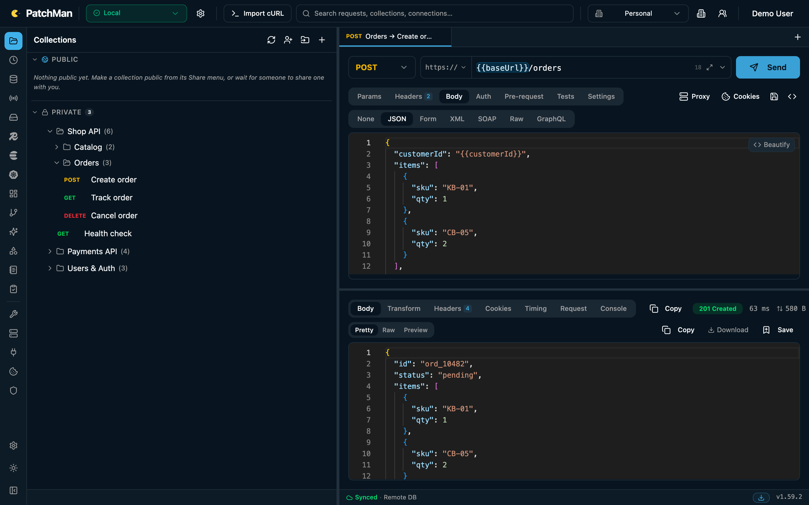
</p>

---

> [!IMPORTANT]
> **This repository is only the front end.** PatchMan UI depends on the PatchMan backend, [patchman-api](https://github.com/PttemDev/patchman-api), and does not work without it. You need a running API (local or remote) for sign-in, collections, connections and every other feature. The desktop app is the exception: it bundles the backend as a sidecar, but building it still requires the `patchman-api` source. See the [Quick start](#quick-start).

## What is PatchMan?

PatchMan started as a Postman-style API client and grew into a single place for the daily work around a backend: the requests you send, the databases and queues behind them, the tests you run against them and the knowledge you keep about them.

- **One app, many tools.** The HTTP client sits next to database, Redis, Elasticsearch, Kafka, RabbitMQ, S3 and Kubernetes browsers, so you don't need a separate tool for each.
- **Self-hosted, for teams.** Run one backend for your team. Workspaces, roles and per-person sharing control who can see and change what. Connection secrets are encrypted at rest.
- **Desktop and web.** Use it in the browser against your server, or install the desktop app. The desktop app also works offline without an account.
- **Built for AI agents.** PatchMan is an MCP server with **119 tools**. Agents such as Claude Code, Claude Desktop or Cursor can send requests, query data, file test cases, draw diagrams and keep a shared long-term memory, with per-token permissions.

---

## Screenshots

All screenshots use demo data.

| | |
|---|---|
| <br/><sub><b>Request builder.</b> Collections and folders, `{{variables}}` from the active environment, a JSON body editor and a pretty-printed response with timing.</sub> | 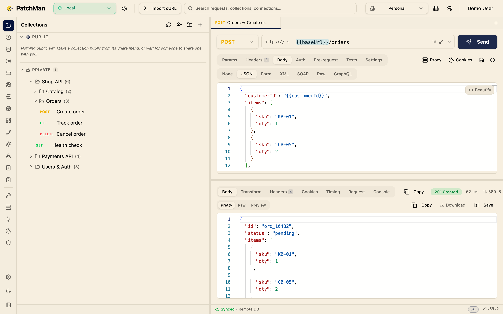<br/><sub><b>Light theme.</b> Light and dark theme presets.</sub> |
| 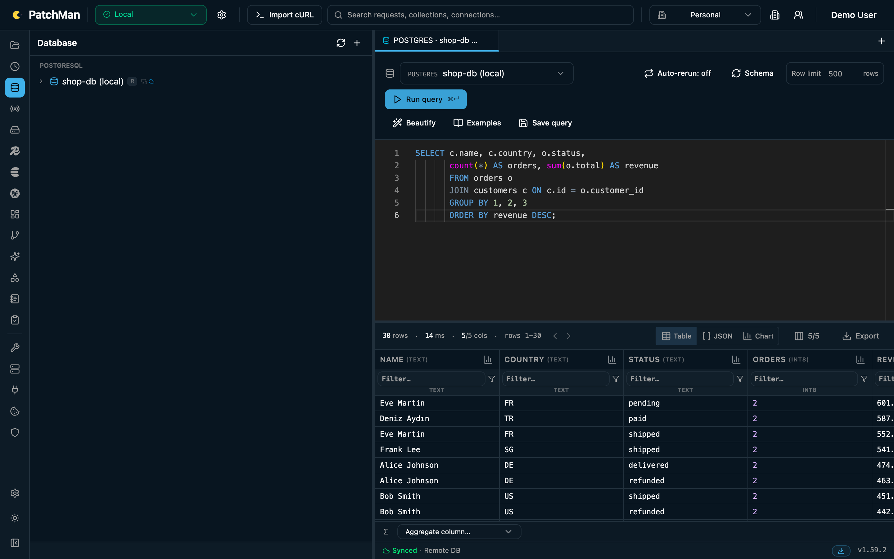<br/><sub><b>Database.</b> Run SQL against PostgreSQL, MySQL, SQL Server or MongoDB. The result grid has filters, aggregates, a chart and an export.</sub> | 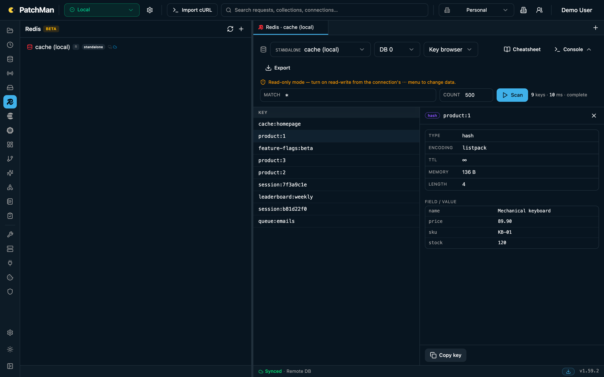<br/><sub><b>Redis.</b> A key browser with smart pattern matching, per-type value views and TTLs. Connections are read-only unless you turn writes on.</sub> |
| 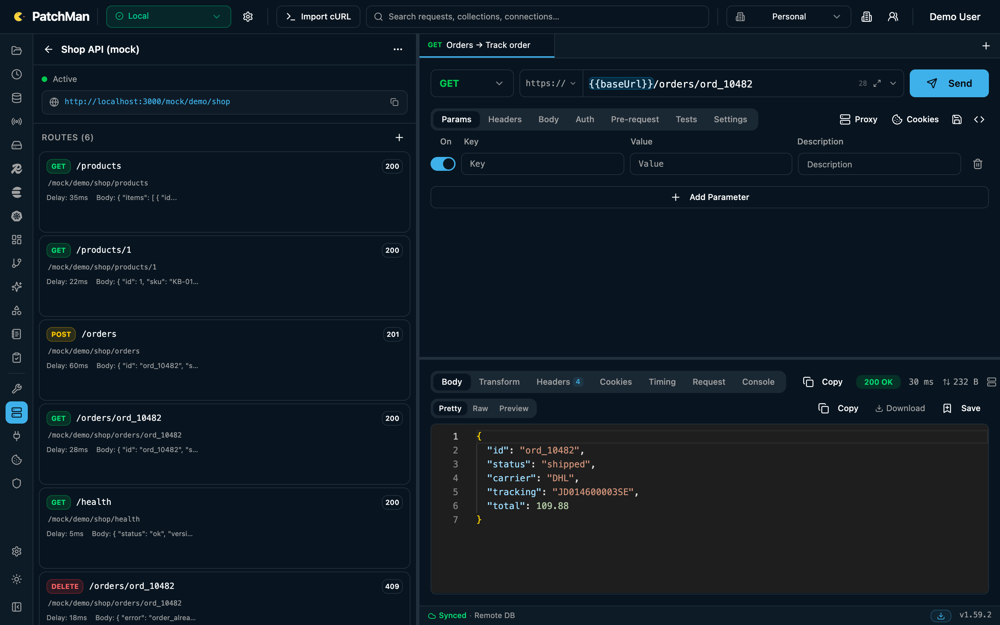<br/><sub><b>Mock servers.</b> Define routes with a status, headers, body and delay, then call them from the request builder.</sub> | 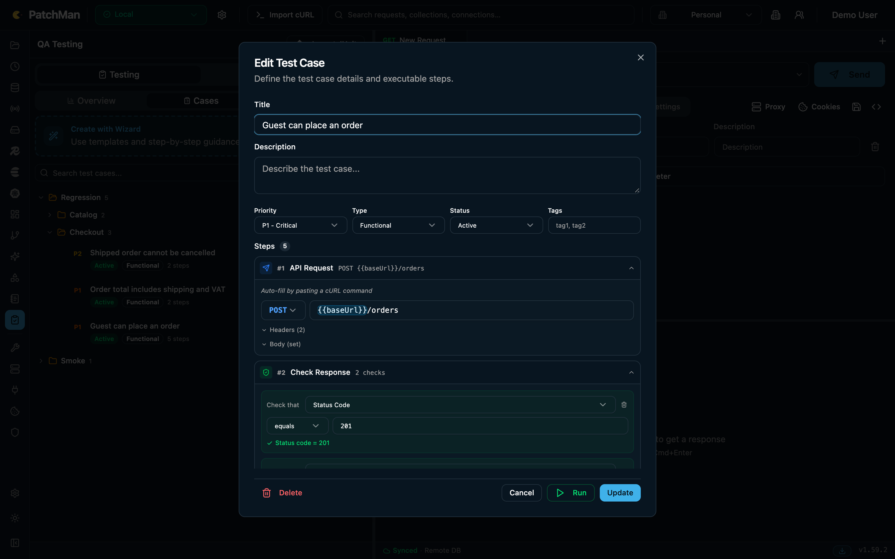<br/><sub><b>QA test cases.</b> Request, check, extract and wait steps, organized in folders. Run one case or a whole folder.</sub> |
| 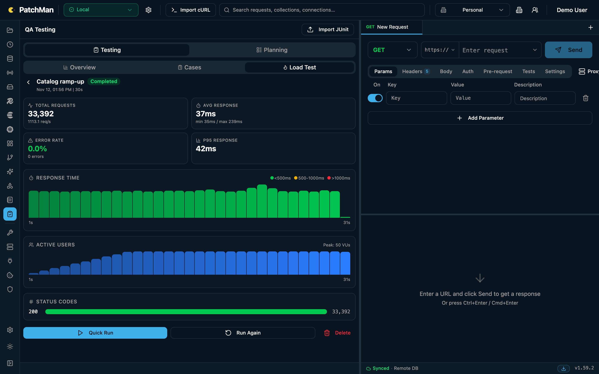<br/><sub><b>Load testing.</b> Constant, ramp-up, spike, soak and stress profiles, with live latency and active-user charts and status-code counts.</sub> | 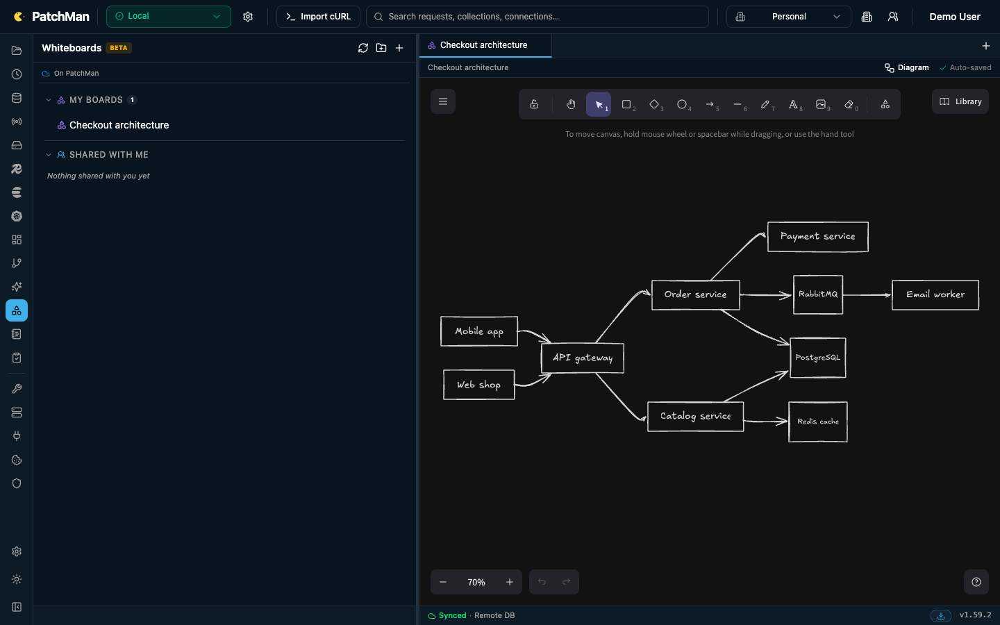<br/><sub><b>Whiteboards.</b> Excalidraw boards in folders, with real-time collaboration and share links. Agents can draw Mermaid diagrams onto them.</sub> |
| 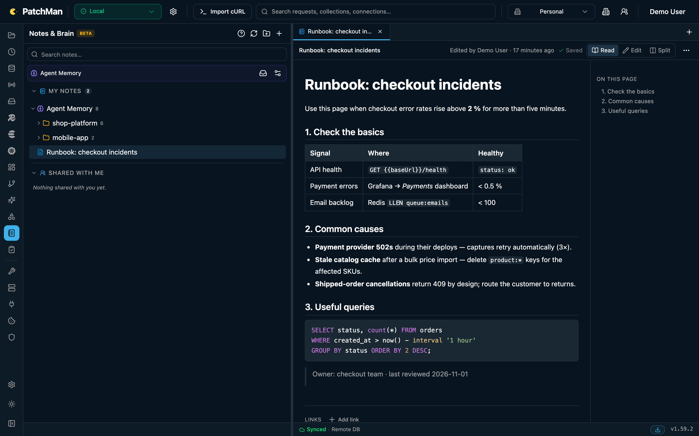<br/><sub><b>Notes.</b> A markdown knowledge base with tables, code blocks, an outline, revisions and sharing.</sub> | 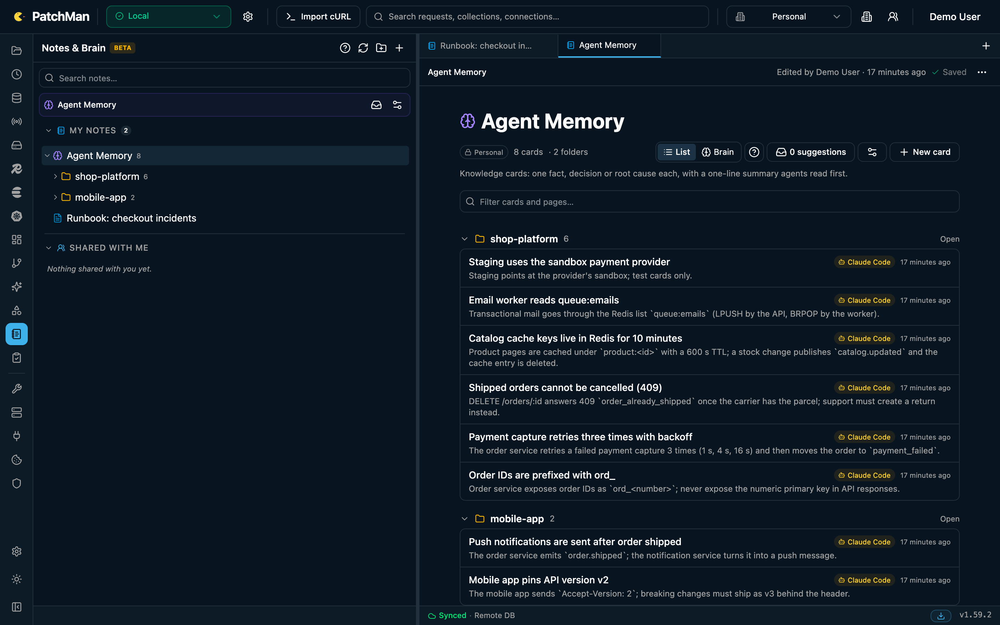<br/><sub><b>Agent Memory.</b> Facts your agents saved, grouped by project and signed with the agent's name.</sub> |
| 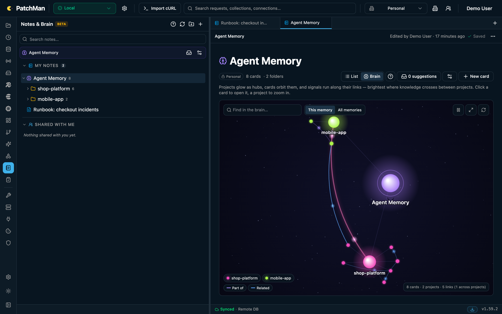<br/><sub><b>Brain.</b> The same memory drawn as a live graph of projects, cards and their links.</sub> | 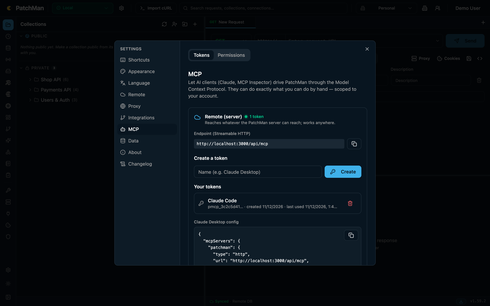<br/><sub><b>MCP settings.</b> The endpoint, personal tokens with permission groups, and ready-to-paste client config.</sub> |

---

## Features

### API client
- HTTP methods with params, headers, body (JSON, form, multipart, XML, raw, binary, GraphQL, SOAP) and auth (Bearer, Basic, API key, OAuth 2.0, Digest, AWS Signature, Hawk, NTLM).
- `{{variable}}` highlighting with hover-to-edit and autocomplete. Pre-request and test scripts.
- A response viewer with pretty, raw and preview modes, headers, cookies, timing and a transform tab. Save responses as examples.
- History, a cookie jar, a proxy mode, and requests sent from the backend so browser CORS rules don't get in the way.
- Code generation for cURL, Python, JavaScript (fetch and axios), Go, Java, C#, PHP, Ruby, Swift, Kotlin, Rust and Dart.
- Import from Postman, OpenAPI / Swagger, cURL and WSDL. Re-sync a collection from its OpenAPI URL.
- A WebSocket client.

### Collections and environments
- Nested collections and folders with drag and drop and a base URL per collection.
- Environments with secret variables that are masked for viewers. Share environments with people and teams.

### Data and infrastructure tools
Every connection uses the same model: credentials are stored encrypted, and the connection can be shared with people or teams with a role.

| Tool | What you can do |
|---|---|
| **Databases** | PostgreSQL (and Cockroach, Yugabyte, Redshift), MySQL (and MariaDB, TiDB), SQL Server and MongoDB. Editor with examples and saved queries, schema browser, result grid with filters, aggregates, charts and export. |
| **Redis** | Key browser with smart SCAN, typed value views, TTL and memory, a console and a cheatsheet. Read-only by default. |
| **Elasticsearch** | Index and alias browser, mappings, and a console with completion, drafts and saved queries. |
| **Kafka** | Brokers, topics with sizes, consumer groups and lag, and message peek. Peek never commits offsets. |
| **RabbitMQ** | Overview, queues, exchanges, topology, peek with requeue, publish, a live tail and moving messages out of a DLQ. |
| **S3** | Buckets and objects. |
| **Kubernetes** | Contexts, resources, pod logs with search and download, an exec terminal, apply, and historical pod metrics from Prometheus. |

### Observability and dashboards
- **Grafana:** native dashboard rendering through the Grafana HTTP API, using a token, basic auth or anonymous access.
- **Graylog:** log search with a histogram, streams and field-level drill-down. Read-only.
- **Service map:** a live, animated map built from APM providers (Coroot, Prometheus-compatible backends, Jaeger, Kiali, SigNoz, Datadog).

### Git and CI/CD (GitLab)
- Repositories and branches, and merge requests with diffs and notes.
- CI/CD: pipelines and jobs (including trigger jobs and downstream pipelines), job logs, schedules shown in plain words, and variables. Values are revealed one at a time, and each reveal is audited.

### QA and performance
- Test cases with request, check (status, body, JSON path, header, response time), extract and wait steps.
- Nested folders, running a whole folder, run history, test planning and JUnit import.
- Load tests with five profiles, thresholds and live results.

### Whiteboards, notes and Brain
- Excalidraw whiteboards with folders, real-time collaboration, read-only or read-write share links, and AI-generated diagrams from live data.
- Notes: markdown pages with images, revisions, backlinks and sharing.
- **Agent Memory** and **Brain:** the long-term memory your AI agents write to (see below).

### Teams, security and operations
- Personal and team workspaces with Admin, Editor and Viewer roles. Share connections, collections, boards and notes with people or teams.
- Sign in with email and password or GitLab SSO. Sessions slide while you stay active.
- Connection secrets are encrypted with AES using a key you provide (`GITLAB_TOKEN_ENC_KEY`).
- An audit log and activity feed, plus admin usage views.
- The UI is available in English, Turkish, Spanish and Chinese.

### Desktop app
- A Tauri 2 desktop app with an embedded backend (a Go sidecar using SQLite).
- Works offline without an account. Sign in later to sync to your server.
- Menu-bar tray, an auto-update channel and a built-in Claude Code terminal. Updates for your own builds need your own endpoint and signing key (see [Desktop app notes](#desktop-app-notes)).
- macOS is the supported desktop target. Windows and Linux builds are not verified yet.

---

## AI agents (MCP)

PatchMan is a [Model Context Protocol](https://modelcontextprotocol.io) server. Agents get tools for everything above: sending HTTP requests, querying databases, Redis, Elasticsearch, Kafka, RabbitMQ, S3 and Kubernetes, reading GitLab merge requests and CI, editing collections, test cases and mock servers, and drawing on whiteboards.

**Two ways to connect**

| | Remote (server) | Local (desktop app) |
|---|---|---|
| Transport | Streamable HTTP at `https://<your-server>/api/mcp` | stdio bridge `~/.patchman/bin/patchman-mcp` |
| Auth | Personal token (`pmcp_…`) from **Settings → MCP** | None; the bridge finds the running app by itself |
| Where tools run | On the server: requests and queries reach what the server reaches | In the desktop app: requests and queries reach what your machine reaches (localhost, VPN) |

Claude Code:
```bash
claude mcp add --transport http patchman https://<your-server>/api/mcp \
  --header "Authorization: Bearer pmcp_..."
```

Claude Desktop / Cursor (`mcpServers`):
```json
{
  "mcpServers": {
    "patchman": {
      "type": "http",
      "url": "https://<your-server>/api/mcp",
      "headers": { "Authorization": "Bearer pmcp_..." }
    }
  }
}
```

**Permissions.** Each token can be limited to a set of tool groups: `collections`, `requests`, `environments`, `testcases`, `mocks`, `connections`, `http`, `db`, `es`, `redis`, `kafka`, `s3`, `k8s`, `git`, `devtools`, `whiteboards`, `notes`, `grafana`, `rabbitmq`, `observability`, `graylog`.

**Agent Memory.**
- `remember` saves one fact per card: a decision, a root cause or a convention. `recall` finds cards again, ranked for the project the agent works in.
- Cards are grouped into projects. Through the stdio bridge the project is the agent's working directory; remote clients pass `project`. Each card is signed with the agent's name.
- Memories can be personal, shared with a team, or shared with a colleague. `recall(from: "<name>")` searches only what that person shared with you.
- A secret filter refuses credentials.

---

## Quick start

The UI needs the API, so you run two things: the backend ([patchman-api](https://github.com/PttemDev/patchman-api)) and this web UI. The fastest way to try PatchMan is the backend on SQLite and the web UI in dev mode. No external services are needed.

**Requirements:** Go 1.26 (use the latest 1.26.x patch release), Node.js and npm (tested with Node.js 22), and `openssl` for generating keys.

Clone both repositories next to each other:

```bash
git clone https://github.com/PttemDev/patchman-api.git
git clone https://github.com/PttemDev/patchman-ui.git
```

**1. Backend** (port 8085)

```bash
cd patchman-api
mkdir -p bin data
go build -o bin/patchman-server ./cmd/server

JWT_SECRET=$(openssl rand -hex 32) \
GITLAB_TOKEN_ENC_KEY=$(openssl rand -base64 32) \
DB_DRIVER=sqlite DB_PATH=./data/patchman.db PORT=8085 \
ALLOWED_REDIRECT_ORIGINS=http://localhost:3000 \
REALTIME_ALLOWED_ORIGINS=http://localhost:3000 \
./bin/patchman-server
```

> Keep `JWT_SECRET` and `GITLAB_TOKEN_ENC_KEY` the same across restarts, or you'll be signed out and stored connection secrets can't be decrypted. Put them in a `.env` file next to where you start the server; it is loaded automatically.

**2. Web UI** (port 3000; proxies `/api` and `/mock` to `localhost:8085`)

```bash
cd patchman-ui
npm ci
npm run dev
```

**3.** Open <http://localhost:3000>, click **Sign up** and create the first account. To make it the admin, set `DEFAULT_ADMIN_EMAIL` to its address and restart the backend.

### Running on PostgreSQL

Server mode uses PostgreSQL unless `DB_DRIVER=sqlite`. The backend repository ships a compose file for local development:

```bash
cd patchman-api/db
docker compose up -d   # PostgreSQL 16

cd ..
DB_HOST=localhost DB_PORT=5432 DB_NAME=getman DB_USER=getman DB_PASSWORD=getman123 \
JWT_SECRET=... GITLAB_TOKEN_ENC_KEY=... ./bin/patchman-server
```

The database name, user and password above are local development defaults from the compose file. Use your own credentials for anything beyond a local try-out.

### Desktop app (macOS)

The desktop build compiles the Go backend from the `patchman-api` repository as a sidecar. It looks for a sibling checkout named `patchman-api` (as in the clone step above). Set `PATCHMAN_API_DIR` if yours lives elsewhere. You also need a Rust toolchain.

```bash
cd patchman-ui
npm ci
npm run tauri:dev     # dev build with the embedded backend
npm run tauri:build   # release build (.app/.dmg); signing and notarization read Apple credentials from env
```

See [Desktop app notes](#desktop-app-notes) before publishing builds.

---

## Configuration

The backend reads environment variables, plus `.env` (or `.env.<APP_ENV>`) from its working directory. Copy `.env.example` in the `patchman-api` repository to start.

| Variable | Default | Purpose |
|---|---|---|
| `PORT` | `8085` | HTTP port. |
| `APP_MODE` | `server` | `server` for a shared backend, `embedded` for the desktop sidecar. |
| `DB_DRIVER` | `postgres` (server mode) | `postgres` or `sqlite`. |
| `DB_PATH` | — | SQLite file when `DB_DRIVER=sqlite`. |
| `DB_HOST` `DB_PORT` `DB_NAME` `DB_USER` `DB_PASSWORD` `DB_SSLMODE` | `localhost` `5432` … `disable` | PostgreSQL connection. |
| `JWT_SECRET` | insecure placeholder | **Required in production.** Signs session tokens. |
| `SESSION_TTL` | `720h` | Session lifetime. Active sessions keep refreshing. |
| `GITLAB_TOKEN_ENC_KEY` | — | **Required.** Base64 of 32 random bytes (`openssl rand -base64 32`). Master key for **all** stored connection secrets; the name is historical. Without a valid key, the routes for encrypted connections are not registered. |
| `ALLOWED_EMAIL_DOMAINS` | — (any) | Comma-separated domains allowed to sign up. |
| `DEFAULT_ADMIN_EMAIL` | — | Bootstrap admin: promoted to admin on start and protected from demotion. |
| `ALLOWED_REDIRECT_ORIGINS` | — | Web origins allowed for SSO redirects. |
| `REALTIME_ALLOWED_ORIGINS` | — | Origins allowed to open real-time (whiteboard collaboration) sockets. |
| `GITLAB_BASE_URL` | `https://gitlab.com` | GitLab instance for SSO and the Git tools. |
| `GITLAB_OAUTH_CLIENT_ID` / `GITLAB_OAUTH_CLIENT_SECRET` | — | Enables "Sign in with GitLab". |
| `SLACK_ERROR_WEBHOOK_URL` | — | Optional crash reports to Slack. |

Web UI build-time variables (all optional; see `.env.example` and `.env.tenant.example`). Vite bakes them into the static bundle, so changing them requires a new build, and they must never contain secrets.

| Variable | Purpose |
|---|---|
| `VITE_API_URL` | Backend base URL. Leave empty (or `/api`) to use the same-origin proxy. |
| `VITE_EMAIL_DOMAIN_PLACEHOLDER` | Domain shown in the sign-in email placeholder. |
| `VITE_GITLAB_HOSTNAME` | GitLab hostname shown in UI copy. |

### Docker (web UI)

```bash
docker build \
  --build-arg VITE_API_URL=https://patchman-api.example.com/api \
  -t patchman-ui .

docker run -p 3000:3000 patchman-ui
```

The image only serves the static UI. It expects a running [patchman-api](https://github.com/PttemDev/patchman-api) at the URL you pass in `VITE_API_URL`. Without a reachable API, sign-in and all data features will not work.

`VITE_API_URL`, `VITE_GITLAB_HOSTNAME` and `VITE_EMAIL_DOMAIN_PLACEHOLDER` can be passed as build arguments.

### Desktop app notes

This repository does not ship release binaries, signing keys or a working auto-update endpoint. The following values are intentionally left empty or generic. Provide your own to publish desktop builds:

- `plugins.updater.endpoints` and `plugins.updater.pubkey` in `src-tauri/tauri.conf.json` (or in a local `src-tauri/tauri.tenant.json`, see `src-tauri/tauri.tenant.json.example`)
- Your Tauri updater signing key (`TAURI_SIGNING_PRIVATE_KEY`, kept in the gitignored `src-tauri/.keys/`)
- macOS code-signing identity and notarization credentials (`APPLE_ID`, `APPLE_PASSWORD`, `APPLE_TEAM_ID`)
- `PATCHMAN_DOWNLOAD_BASE_URL`, the public URL where you host the staged artifacts (defaults to the placeholder `https://downloads.example.com/patchman`)
- `public/downloads/latest.json`, the update manifest, which `scripts/stage-desktop.mjs` generates on each build. See `public/downloads/latest.json.example` for the format.

The bundle identifier `com.pttem.patchman` in `tauri.conf.json` is the upstream default. Change it if you publish your own fork.

---

## Architecture

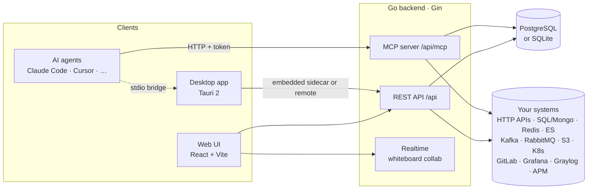

| Part | Repository | Stack |
|---|---|---|
| Backend | [patchman-api](https://github.com/PttemDev/patchman-api) | Go 1.26, Gin, GORM (PostgreSQL / SQLite), MCP Go SDK, franz-go (Kafka), client-go (Kubernetes) |
| Web UI | this repository | React 18, TypeScript, Vite 6, Tailwind CSS 4, Zustand, Monaco editor, Excalidraw, react-i18next |
| Desktop | this repository (`src-tauri/`) | Tauri 2 (Rust) running the Go backend as a sidecar on SQLite |
| MCP bridge | [patchman-api](https://github.com/PttemDev/patchman-api) (`cmd/mcp-bridge`) | stdio ⇄ HTTP bridge for agents talking to the desktop app |

```
patchman-api/   Go backend (cmd/server, cmd/mcp-bridge, internal/…, db/)
patchman-ui/    React web UI + Tauri desktop shell (src-tauri/)
  src/
    components/   feature UI (collections, request, response, mock, qa, runner, …)
    stores/       Zustand stores
    services/     API client
    hooks/ types/ shared hooks and types
  docs/           screenshots
```

---

## Development

```bash
# backend (patchman-api)
go build ./... && go test ./...

# web UI (patchman-ui)
npm run lint
npm run build          # tsc -b && vite build
npm run check:i18n     # every UI string present in en / tr / es / zh
```

Conventions:
- Every user-facing string goes through `react-i18next` (`t()`), with translations in all four locales.
- New connection-type tools follow the existing pattern: an encrypted secret, grants, audit entries and an MCP tool group.
- Lazy-loaded UI chunks use `lazyWithReload`, so open tabs survive a deploy.

---

## Security

Checks run on this repository before the initial public release (November 2026):

- [x] `npm run build` and `npm run check:i18n` pass
- [x] Source tree and production bundle scanned for committed secrets, `.env` files, signing keys and internal hostnames; none found
- [x] Release binaries and update manifests are not part of the repository
- [x] `npm audit` reports no critical or high severity advisories
- [ ] `npm audit` still reports 13 moderate/low advisories that need major upgrades or have no upstream fix yet (`react-router-dom` 6 → 7, `katex` via `mermaid`, `@excalidraw/*`, and the `typescript-eslint` / `minimatch` dev tooling). See [SECURITY.md](SECURITY.md).

Dependency notes: `xlsx` is installed from the SheetJS CDN (`0.20.3`) because newer releases are not published to npm, and `package.json` uses `overrides` to pin patched versions of `lodash-es`, `dompurify` and `nanoid`.

These checks are a point-in-time snapshot, not a security audit. Run `npm audit` regularly. To report a vulnerability, see [SECURITY.md](SECURITY.md).

## Contributing

Contributions are welcome: bug reports, fixes, new connection types and translations. See [CONTRIBUTING.md](CONTRIBUTING.md) for setup and the pull request flow.

Please report security issues privately, as described in [SECURITY.md](SECURITY.md), rather than in public issues.

## License

MIT. See [LICENSE](LICENSE).
