<h1 align="center">PatchMan</h1>

<p align="center">
  <strong>A self-hosted workbench for API and backend teams.</strong><br/>
  Send requests, query databases, browse Redis and Kafka, run tests and load tests,<br/>
  draw architecture, keep runbooks, and let your AI agents do all of it over MCP.
</p>

<p align="center">
  <a href="LICENSE"></a>
  <a href="https://join.slack.com/t/patchman-workspace/shared_invite/zt-4hjqey19u-~AxNN3qSh51RbOsedKTwdw"></a>
</p>

<p align="center">
  <a href="https://github.com/PttemDev/patchman-ui/releases/latest"></a>
  <a href="https://github.com/PttemDev/patchman-ui/releases/latest"></a>
  <a href="https://github.com/PttemDev/patchman-ui/releases/latest"></a><br/>
  <sub>macOS: signed and notarized · Windows and Linux: preview builds · <a href="#download">download details</a></sub>
</p>

<p align="center">
  <a href="https://join.slack.com/t/patchman-workspace/shared_invite/zt-4hjqey19u-~AxNN3qSh51RbOsedKTwdw"></a><br/>
  <sub>Questions, feedback, feature ideas and release news. Come say hi.</sub>
</p>

<p align="center">
  <strong>Use it standalone or as a team.</strong> On your own, the desktop app runs its own backend on your Mac, with no server or account needed.<br/>
  For a team, self-host <a href="https://github.com/PttemDev/patchman-api">patchman-api</a> and sign in from the web or desktop app to share collections, connections and notes.
</p>

<p align="center">
  <a href="#quick-start">Quick start</a> ·
  <a href="#features">Features</a> ·
  <a href="#ai-agents-mcp">AI agents (MCP)</a> ·
  <a href="#configuration">Configuration</a> ·
  <a href="#architecture">Architecture</a> ·
  <a href="#security">Security</a> ·
  <a href="#contributing">Contributing</a>
</p>

<p align="center">
  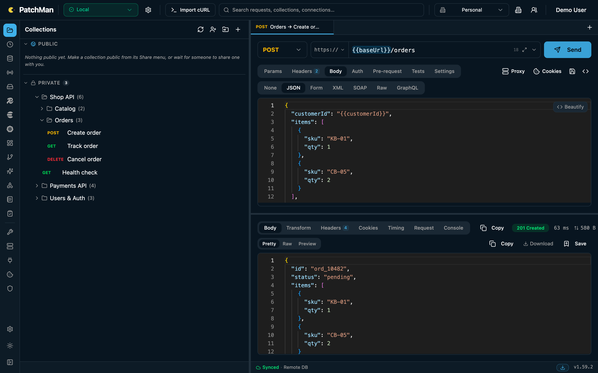
</p>

---

> [!IMPORTANT]
> **This repository is only the front end.** PatchMan UI depends on the PatchMan backend, [patchman-api](https://github.com/PttemDev/patchman-api), and does not work without it. You need a running API (local or remote) for sign-in, collections, connections and every other feature. The one exception is the desktop app: it bundles its own backend and runs standalone and offline (see [Download](#download)). Building the desktop app from source still requires the `patchman-api` source. See the [Quick start](#quick-start).

## What is PatchMan?

PatchMan started as a Postman-style API client and grew into a single place for the daily work around a backend: the requests you send, the databases and queues behind them, the tests you run against them and the knowledge you keep about them.

- **One app, many tools.** The HTTP client sits next to database, Redis, Elasticsearch, Kafka, RabbitMQ, S3, Kubernetes and Google Cloud browsers, plus a Git workspace for GitLab, GitHub and local folders, so you don't need a separate tool for each.
- **Self-hosted, for teams.** Run one backend for your team. Workspaces, roles and per-person sharing control who can see and change what. Connection secrets are encrypted at rest.
- **Desktop and web.** Use it in the browser against your server, or install the desktop app. The desktop app also works offline without an account.
- **Built for AI agents.** PatchMan is an MCP server with **more than 130 tools**, and installed plugins can add their own. Agents such as Claude Code, Claude Desktop or Cursor can send requests, query data, file test cases, draw diagrams and keep a shared long-term memory, with per-token permissions.

---

## Download

Download the desktop app from the [latest GitHub Release](https://github.com/PttemDev/patchman-ui/releases/latest):

| Platform | File | Notes |
|---|---|---|
| macOS (Apple Silicon) | `PatchMan-<version>-aarch64.dmg` | Signed with a Developer ID and notarized by Apple. |
| Windows 10/11 (x64) | `PatchMan-<version>-x64-setup.exe` or `PatchMan-<version>-x64.msi` | Preview. Not code-signed: SmartScreen shows "Windows protected your PC"; choose **More info → Run anyway**. Needs WebView2, which the installer adds if it is missing. |
| Linux (x64) | `PatchMan-<version>-amd64.AppImage` or `PatchMan-<version>-amd64.deb` | Preview. Built on Ubuntu 22.04; needs WebKitGTK 4.1. For the AppImage, run `chmod +x` first. |

Each release also has a `SHA256SUMS` file for checking the downloads (only the lines for the files you downloaded are checked):

```bash
shasum -a 256 -c SHA256SUMS --ignore-missing     # macOS
sha256sum -c SHA256SUMS --ignore-missing         # Linux, or Git Bash / WSL on Windows
```

**Windows and Linux are preview builds.** They are built by GitHub Actions ([`desktop-release.yml`](.github/workflows/desktop-release.yml)) from the same tag, without code signing, and have fewer desktop security features than macOS: there is no app lock and no step-up check before a secret is revealed, and the key that encrypts your saved secrets is kept in a file next to the local database (readable only by your user account) instead of the macOS Keychain. 
**Updates.** From 1.70.0, the app checks the latest GitHub Release (Settings → Updates, and in the background about once an hour). A new version is downloaded, its signature is checked against the public key built into the app, and it is installed after a restart. On Linux this works for the AppImage and the `.deb`; on Windows for the installer and the MSI. Earlier versions (1.69.x and older) can't update themselves: download 1.70.0 once by hand.

Every release has a matching `v<version>` tag in this repository and in [patchman-api](https://github.com/PttemDev/patchman-api), so you can see which source a build came from. To get notified about new versions, use **Watch → Custom → Releases**. Earlier versions are on the [Releases page](https://github.com/PttemDev/patchman-ui/releases). To build the desktop app yourself, see [Desktop app (build from source)](#desktop-app-build-from-source).

The desktop app runs **standalone and offline**. It bundles its own backend (SQLite), so you do not need a server or the `patchman-api` repository to use a built copy. Sign in to a server later if you want to sync.

---

## Screenshots

All screenshots use demo data.

| | |
|---|---|
| <br/><sub><b>Request builder.</b> Collections and folders, `{{variables}}` from the active environment, a JSON body editor and a pretty-printed response with timing.</sub> | 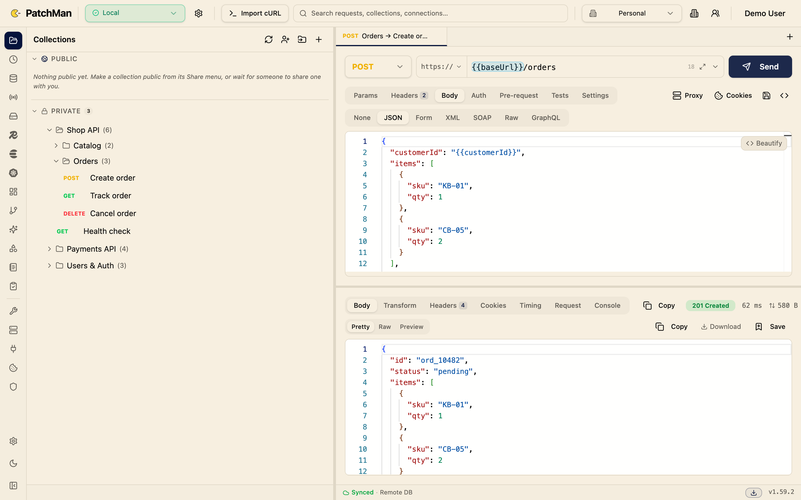<br/><sub><b>Light theme.</b> Light and dark theme presets.</sub> |
| 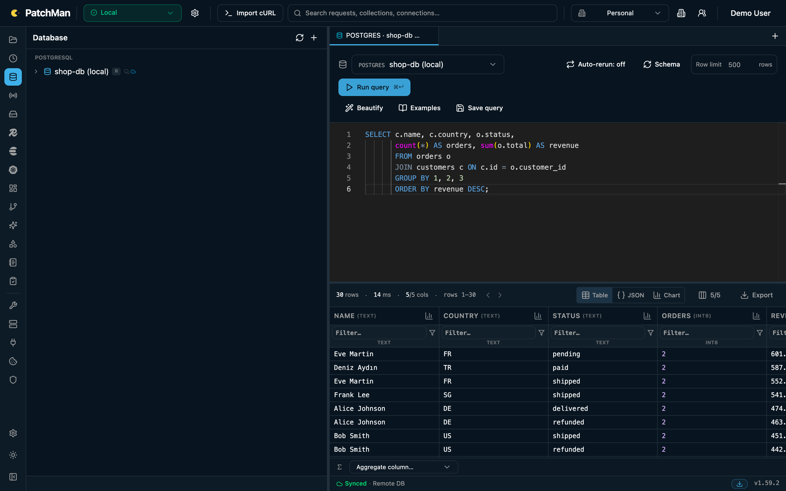<br/><sub><b>Database.</b> Run SQL against PostgreSQL, MySQL, SQL Server or MongoDB. The result grid has filters, aggregates, a chart and an export.</sub> | 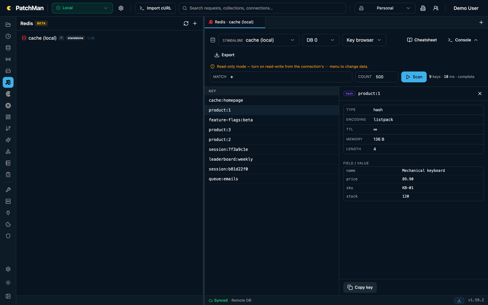<br/><sub><b>Redis.</b> A key browser with smart pattern matching, per-type value views and TTLs. Connections are read-only unless you turn writes on.</sub> |
| 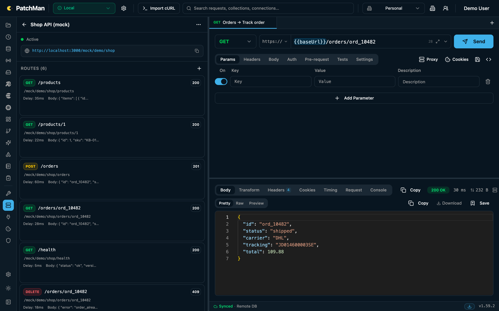<br/><sub><b>Mock servers.</b> Define routes with a status, headers, body and delay, then call them from the request builder.</sub> | 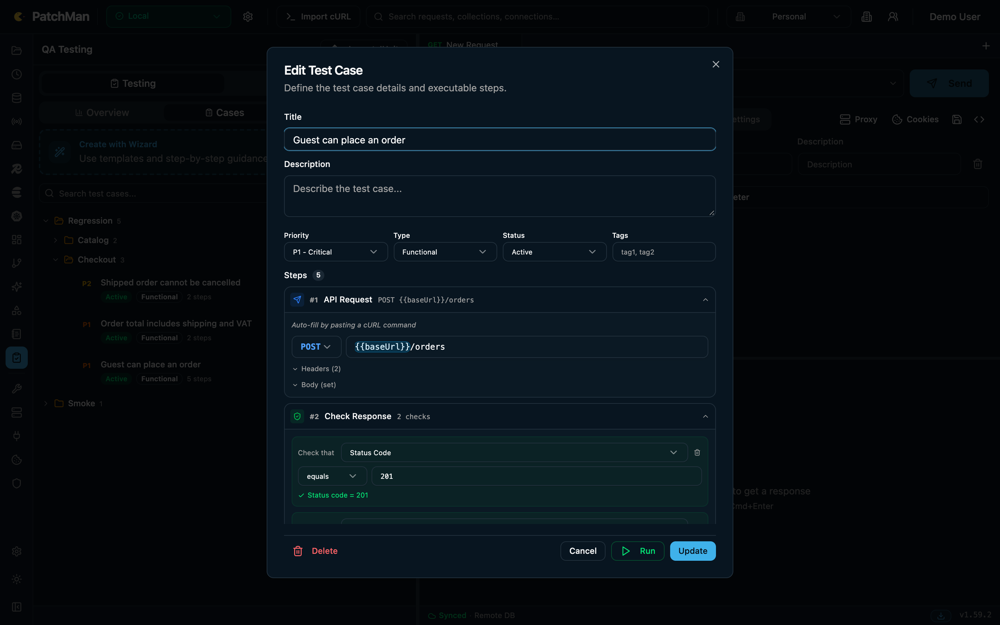<br/><sub><b>QA test cases.</b> Request, check, extract and wait steps, organized in folders. Run one case or a whole folder.</sub> |
| 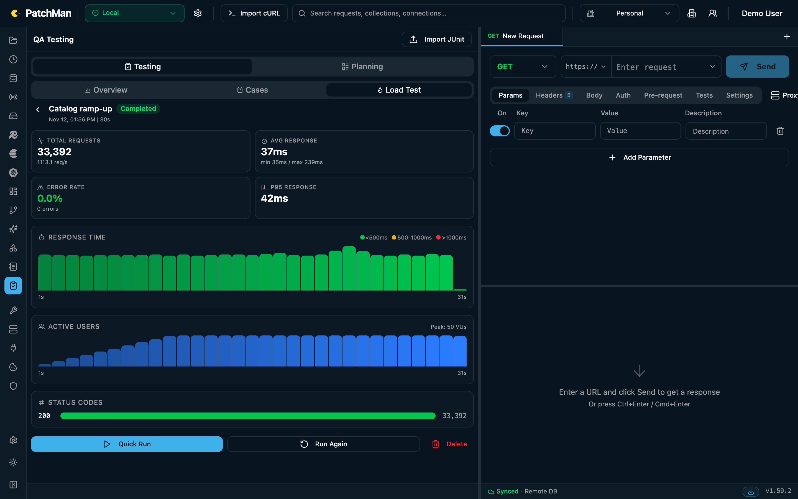<br/><sub><b>Load testing.</b> Constant, ramp-up, spike, soak and stress profiles, with live latency and active-user charts and status-code counts.</sub> | 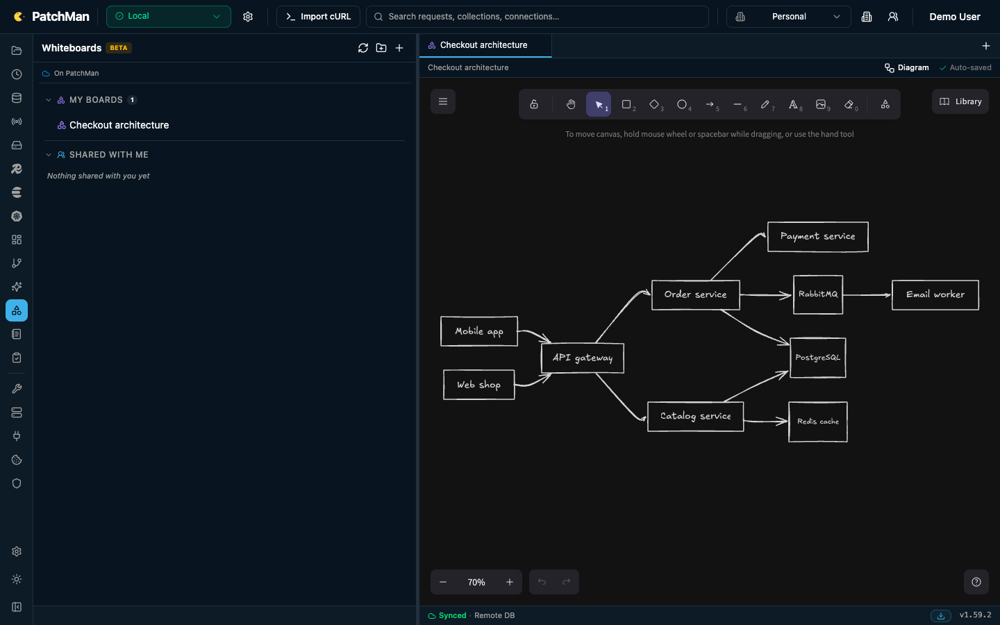<br/><sub><b>Whiteboards.</b> Excalidraw boards in folders, with real-time collaboration and share links. Agents can draw Mermaid diagrams onto them.</sub> |
| 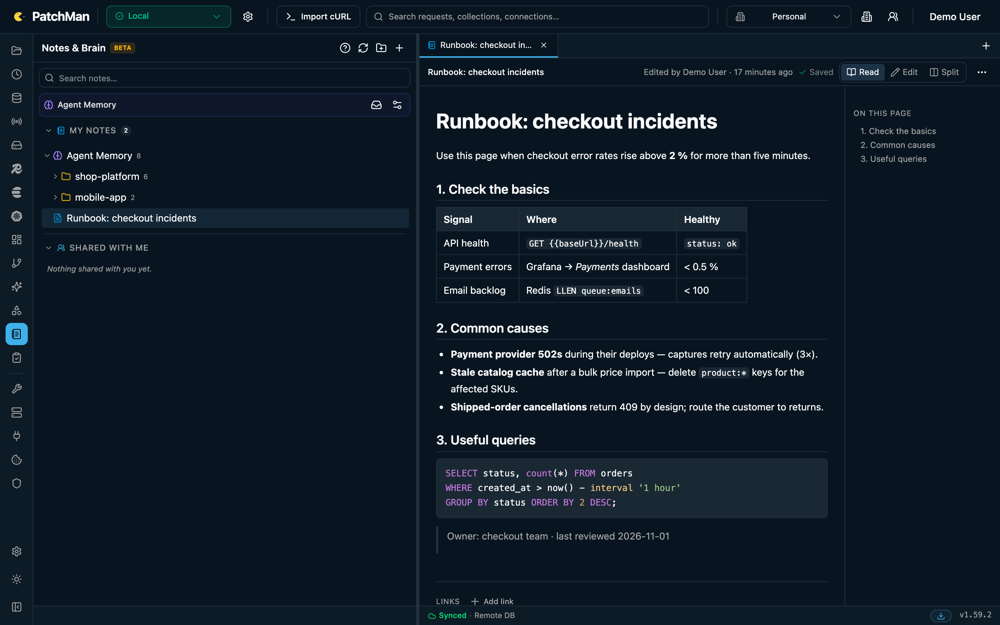<br/><sub><b>Notes.</b> A markdown knowledge base with tables, code blocks, an outline, revisions and sharing.</sub> | 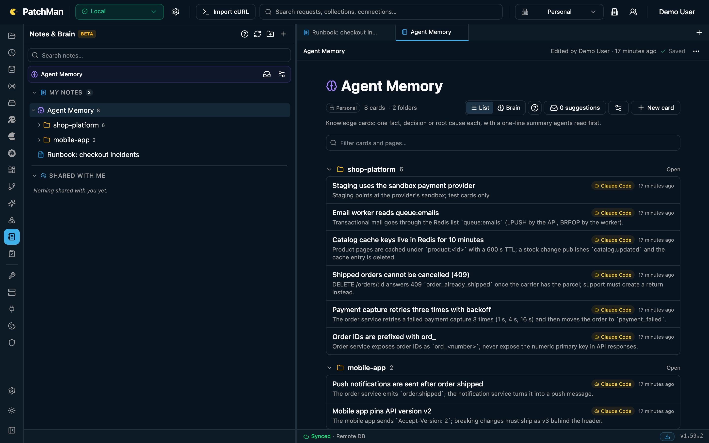<br/><sub><b>Agent Memory.</b> Facts your agents saved, grouped by project and signed with the agent's name.</sub> |
| 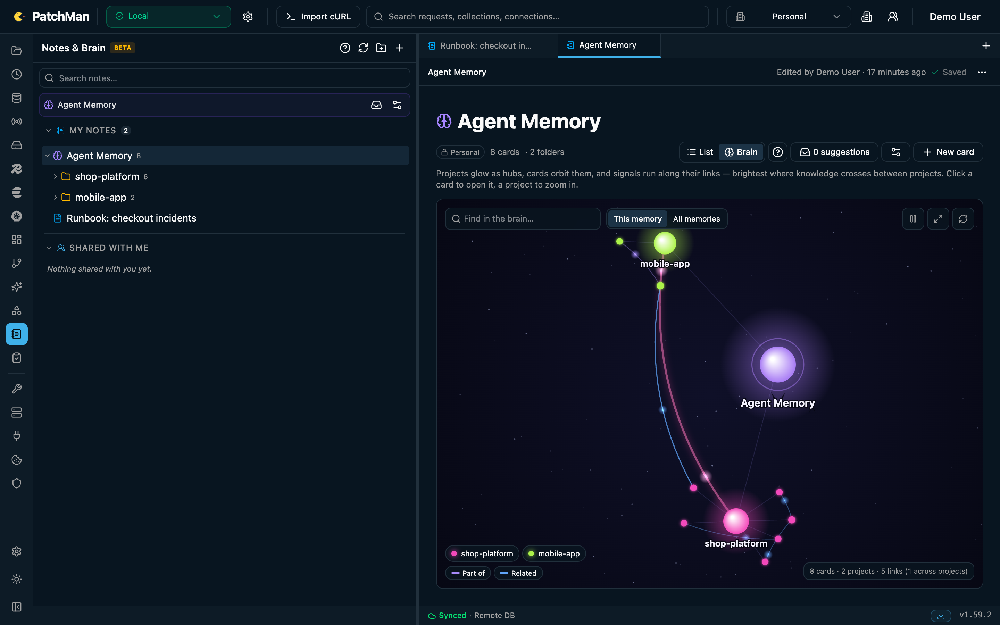<br/><sub><b>Brain.</b> The same memory drawn as a live graph of projects, cards and their links.</sub> | 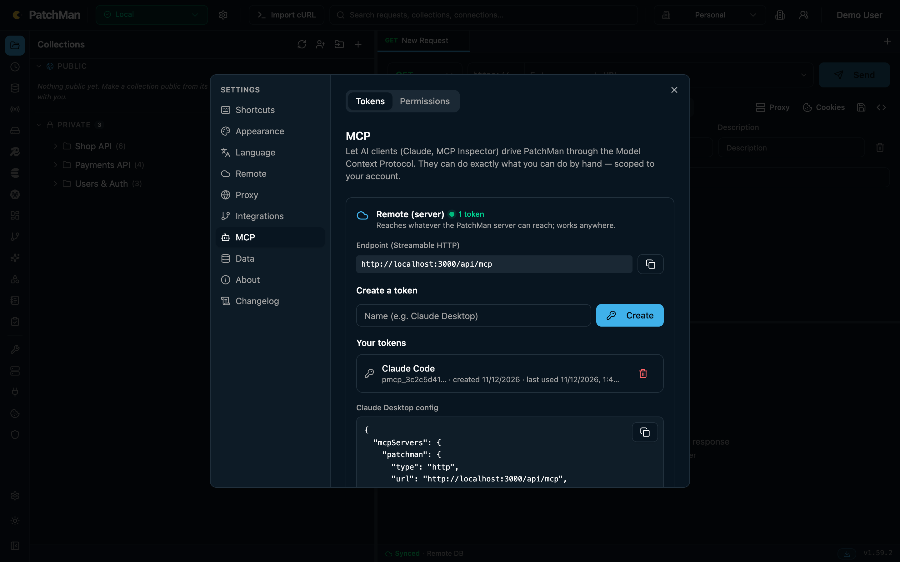<br/><sub><b>MCP settings.</b> The endpoint, personal tokens with permission groups, and ready-to-paste client config.</sub> |

---

## Features

### API client
- HTTP methods with params, headers, body (JSON, form, multipart, XML, raw, binary, GraphQL, SOAP) and auth (Bearer, Basic, API key, OAuth 2.0, Digest, AWS Signature, Hawk, NTLM).
- `{{variable}}` highlighting with hover-to-edit and autocomplete. Pre-request and test scripts.
- A response viewer with pretty, raw and preview modes, headers, cookies, timing and a transform tab. Save responses as examples.
- History, a cookie jar, a proxy mode, and requests sent from the backend so browser CORS rules don't get in the way.
- Code generation for cURL, Python, JavaScript (fetch and axios), Go, Java, C#, PHP, Ruby, Swift, Kotlin, Rust and Dart.
- Import from Postman, OpenAPI / Swagger, cURL and WSDL. Re-sync a collection from its OpenAPI URL.
- A WebSocket client.

### Collections and environments
- Nested collections and folders with drag and drop (reorder and move requests and folders between collections) and a base URL per collection.
- Environments with secret variables that are masked for viewers. Share environments with people and teams.

### Data and infrastructure tools
Every connection uses the same model: credentials are stored encrypted, and the connection can be shared with people or teams with a role.

| Tool | What you can do |
|---|---|
| **Databases** | PostgreSQL (and Cockroach, Yugabyte, Redshift), MySQL (and MariaDB, TiDB), SQL Server, MongoDB and BigQuery. Editor with examples and saved queries, schema browser, result grid with filters, aggregates, charts and export. MongoDB adds index management, explain plans and an aggregation pipeline builder. BigQuery checks every query with a free dry run first and enforces scan limits you set (per query, per connection, or a server-wide ceiling). |
| **Redis** | Key browser with smart SCAN, typed value views, TTL and memory, a console and a cheatsheet. Read-only by default. |
| **Elasticsearch** | Index and alias browser, mappings, Kibana data views with search, and a console with completion, drafts and saved queries. |
| **Kafka** | Brokers, topics with sizes, consumer groups and lag, and message peek. Peek never commits offsets. |
| **RabbitMQ** | Overview, queues, exchanges, topology, peek with requeue, publish, a live tail and moving messages out of a DLQ. |
| **S3** | Buckets and objects. |
| **Kubernetes** | Contexts, resources, pod logs with search and download, an exec terminal, apply, and historical pod metrics from Prometheus. |
| **Google Cloud** | Projects, Cloud Storage buckets and objects, Pub/Sub topics and subscriptions with peek (without consuming) and publish, GKE clusters, Cloud Logging search and BigQuery. Connect with a service account key, gcloud on this computer (desktop), or your Google account (web). |

### Observability and dashboards
- **Grafana:** native dashboard rendering through the Grafana HTTP API, using a token, basic auth or anonymous access.
- **Graylog:** log search with a histogram, streams and field-level drill-down. Read-only.
- **Service map:** a live, animated map built from APM providers (Coroot, Prometheus-compatible backends, Jaeger, Kiali, SigNoz, Datadog, New Relic). Each service opens a details page with request, error and latency charts, endpoints, errors, instances, health checks and alerts (New Relic, Coroot and Prometheus-compatible backends), and the table has a Services view with requests/s, errors and p95.
- **New Relic:** APM applications with health, request rate, error % and p95, plus a console for NRQL queries, alerts and entities.

### Git and CI/CD (GitLab and GitHub)
- GitLab and GitHub (including GitHub Enterprise Server) connections with a personal access token, or a GitLab account linked through OAuth.
- Repositories, branches, history, commits and files, comparisons and code search.
- Merge requests and pull requests: list, read the conversation, review the changes with line comments, reply to and resolve threads, approve, mark as draft or ready, close or reopen, update the branch, and merge with an editable merge commit message. Descriptions and comments render as markdown.
- CI/CD: GitLab pipelines and jobs (including trigger jobs and downstream pipelines) and GitHub Actions workflow runs, with job logs, retry, run again (also for trigger jobs that wait to be started by hand), schedules shown in plain words, and variables. Values are revealed one at a time, and each reveal is audited.
- A Git workspace that works like an IDE: open any git folder on your computer (desktop) without a connection, edit files with syntax highlighting and auto save, stage, commit, pull, push, and the full JetBrains-style branch menu (checkout, new branch, update a branch you are not on, merge, rebase, compare, rename, delete). Saves are hash-guarded, so a file changed elsewhere is not overwritten. Local folders can be linked to a GitLab project, existing clones on disk are reused, and Markdown files render as a preview while browsing a repository.

### QA and performance
- Test cases with request, check (status, body, JSON path, header, response time), extract and wait steps.
- Nested folders, running a whole folder, run history, test planning and JUnit import.
- Load tests with five profiles, thresholds and live results.

### Whiteboards, notes and Brain
- Excalidraw whiteboards with folders, real-time collaboration, read-only or read-write share links, and AI-generated diagrams from live data.
- Notes: markdown pages with images, revisions, backlinks and sharing.
- **Agent Memory** and **Brain:** the long-term memory your AI agents write to (see below).

### Teams, security and operations
- Personal and team workspaces with Admin, Editor and Viewer roles. Share connections, collections, boards and notes with people or teams.
- Sign in with email and password, GitLab SSO, GitHub or Google (optionally limited to your Google Workspace domains). Each provider's button only appears when the server has it configured.
- Sessions slide while you stay active, with an optional idle timeout (`SESSION_IDLE_TTL`). **Settings → Security** lists the devices signed in to your account; sign out one or all others. Admins can sign a user out everywhere.
- Connection secrets are encrypted with AES using a key you provide (`GITLAB_TOKEN_ENC_KEY`).
- An audit log and activity feed, plus admin usage views.
- The UI is available in English, Turkish, Spanish and Chinese.

### Plugins
- Extend PatchMan with plugins: WebAssembly modules (built with [Extism](https://extism.org)) that add connection types, screens and MCP tools.
- Each plugin runs in a sandbox: it reaches only the hosts it declares, sees only its own connection's secrets, and its screens run isolated from the app. Private networks are blocked unless an admin allows them (`PLUGIN_PRIVATE_CIDRS`).
- Signed plugins are checked against trusted publisher keys (`PATCHMAN_PLUGIN_TRUSTED_KEYS`). For plugin authors, the desktop app can restart in developer mode (Touch ID required) to install an unsigned plugin from a local folder for one session.

### Desktop app
- A Tauri 2 desktop app with an embedded backend (a Go sidecar using SQLite).
- Security: only the app itself can talk to its embedded backend (a per-launch token and a strict origin check), a content security policy, an optional app lock with Touch ID or your Mac password (on open and after a period of inactivity), and Touch ID before every secret is revealed. The key that encrypts your saved secrets is kept in the macOS Keychain.
- Works offline without an account. Sign in later to sync to your server.
- Menu-bar tray, updates from GitHub Releases (signed, checked in the background and in Settings → Updates) and a built-in Claude Code terminal.
- macOS is the main desktop target. Windows (x64) and Linux (x64) preview builds are published with each release; the app lock, Touch ID step-up and Keychain storage are macOS only (see [Download](#download)).

---

## AI agents (MCP)

PatchMan is a [Model Context Protocol](https://modelcontextprotocol.io) server. Agents get tools for everything above: sending HTTP requests, querying databases, Redis, Elasticsearch, Kafka, RabbitMQ, S3, Kubernetes and Google Cloud, reading GitLab merge requests, GitHub pull requests and CI, editing collections, test cases and mock servers, and drawing on whiteboards.

**Two ways to connect**

| | Remote (server) | Local (desktop app) |
|---|---|---|
| Transport | Streamable HTTP at `https://<your-server>/api/mcp` | stdio bridge `~/.patchman/bin/patchman-mcp` |
| Auth | Personal token (`pmcp_…`) from **Settings → MCP** | None; the bridge finds the running app by itself |
| Where tools run | On the server: requests and queries reach what the server reaches | In the desktop app: requests and queries reach what your machine reaches (localhost, VPN) |

Claude Code:
```bash
claude mcp add --transport http patchman https://<your-server>/api/mcp \
  --header "Authorization: Bearer pmcp_..."
```

Claude Desktop / Cursor (`mcpServers`):
```json
{
  "mcpServers": {
    "patchman": {
      "type": "http",
      "url": "https://<your-server>/api/mcp",
      "headers": { "Authorization": "Bearer pmcp_..." }
    }
  }
}
```

**Permissions.** Each token can be limited to a set of tool groups: `collections`, `requests`, `environments`, `testcases`, `mocks`, `connections`, `http`, `db`, `es`, `redis`, `kafka`, `s3`, `k8s`, `git`, `devtools`, `whiteboards`, `notes`, `grafana`, `rabbitmq`, `observability`, `graylog`, `gcp`, plus one `plugin:<id>` group per installed plugin.

**Resources, prompts and progress.** Besides tools, PatchMan serves MCP resources and prompts, and long-running tools report progress. Tool replies are compact and suggest the next useful step.

**Agent Memory.**
- `remember` saves one fact per card: a decision, a root cause or a convention. `recall` finds cards again, ranked for the project the agent works in.
- Cards are grouped into projects. Through the stdio bridge the project is the agent's working directory; remote clients pass `project`. Each card is signed with the agent's name.
- Memories can be personal, shared with a team, or shared with a colleague. `recall(from: "<name>")` searches only what that person shared with you.
- Agents can update a card in place with a stable key and remove outdated ones with `forget`. When they connect, agents are told which memories they can read (personal, team and shared).
- A secret filter refuses credentials but accepts code references that only look like them.

---

## Quick start

The UI needs the API, so you run two things: the backend ([patchman-api](https://github.com/PttemDev/patchman-api)) and this web UI. The fastest way to try PatchMan is the backend on SQLite and the web UI in dev mode. No external services are needed.

**Requirements:** Go 1.26 (use the latest 1.26.x patch release), Node.js and npm (tested with Node.js 22), and `openssl` for generating keys.

Clone both repositories next to each other:

```bash
git clone https://github.com/PttemDev/patchman-api.git
git clone https://github.com/PttemDev/patchman-ui.git
```

**1. Backend** (port 8085)

```bash
cd patchman-api
mkdir -p bin data
go build -o bin/patchman-server ./cmd/server

JWT_SECRET=$(openssl rand -hex 32) \
GITLAB_TOKEN_ENC_KEY=$(openssl rand -base64 32) \
DB_DRIVER=sqlite DB_PATH=./data/patchman.db PORT=8085 \
ALLOWED_REDIRECT_ORIGINS=http://localhost:3000 \
REALTIME_ALLOWED_ORIGINS=http://localhost:3000 \
./bin/patchman-server
```

> Keep `JWT_SECRET` and `GITLAB_TOKEN_ENC_KEY` the same across restarts, or you'll be signed out and stored connection secrets can't be decrypted. Put them in a `.env` file next to where you start the server; it is loaded automatically.

**2. Web UI** (port 3000; proxies `/api` and `/mock` to `localhost:8085`)

```bash
cd patchman-ui
npm ci
npm run dev
```

**3.** Open <http://localhost:3000>, click **Sign up** and create the first account. To make it the admin, set `DEFAULT_ADMIN_EMAIL` to its address and restart the backend.

### Running on PostgreSQL

Server mode uses PostgreSQL unless `DB_DRIVER=sqlite`. The backend repository ships a compose file for local development:

```bash
cd patchman-api/db
docker compose up -d   # PostgreSQL 16

cd ..
DB_HOST=localhost DB_PORT=5432 DB_NAME=getman DB_USER=getman DB_PASSWORD=getman123 \
JWT_SECRET=... GITLAB_TOKEN_ENC_KEY=... ./bin/patchman-server
```

The database name, user and password above are local development defaults from the compose file. Use your own credentials for anything beyond a local try-out.

### Desktop app (build from source)

The desktop build compiles the Go backend from the `patchman-api` repository as a sidecar. It looks for a sibling checkout named `patchman-api` (as in the clone step above). Set `PATCHMAN_API_DIR` if yours lives elsewhere. You also need a Rust toolchain. On Linux, install the WebKitGTK 4.1 development packages first (on Ubuntu: `libwebkit2gtk-4.1-dev libxdo-dev libssl-dev libayatana-appindicator3-dev librsvg2-dev`). On Windows, use the MSVC Rust toolchain. To build Windows or Linux packages, run `npm run sidecar:build`, then `npx tauri build --config src-tauri/tauri.tenant.json` with an overlay that sets `"createUpdaterArtifacts": false`.

```bash
cd patchman-ui
npm ci
npm run tauri:dev     # dev build with the embedded backend
npm run tauri:build   # release build (.app/.dmg); signing and notarization read Apple credentials from env
```

See [Desktop app notes](#desktop-app-notes) before publishing builds.

---

## Configuration

The backend reads environment variables, plus `.env` (or `.env.<APP_ENV>`) from its working directory. Copy `.env.example` in the `patchman-api` repository to start.

| Variable | Default | Purpose |
|---|---|---|
| `PORT` | `8085` | HTTP port. |
| `APP_MODE` | `server` | `server` for a shared backend, `embedded` for the desktop sidecar. |
| `DB_DRIVER` | `postgres` (server mode) | `postgres` or `sqlite`. |
| `DB_PATH` | — | SQLite file when `DB_DRIVER=sqlite`. |
| `DB_HOST` `DB_PORT` `DB_NAME` `DB_USER` `DB_PASSWORD` `DB_SSLMODE` | `localhost` `5432` … `disable` | PostgreSQL connection. |
| `JWT_SECRET` | insecure placeholder | **Required in production.** Signs session tokens. |
| `SESSION_TTL` | `720h` | Session lifetime. Active sessions keep refreshing. |
| `GITLAB_TOKEN_ENC_KEY` | — | **Required.** Base64 of 32 random bytes (`openssl rand -base64 32`). Master key for **all** stored connection secrets; the name is historical. Without a valid key, the routes for encrypted connections are not registered. |
| `ALLOWED_EMAIL_DOMAINS` | — (any) | Comma-separated domains allowed to sign up. |
| `DEFAULT_ADMIN_EMAIL` | — | Bootstrap admin: promoted to admin on start and protected from demotion. |
| `ALLOWED_REDIRECT_ORIGINS` | — | Web origins allowed for SSO redirects. |
| `REALTIME_ALLOWED_ORIGINS` | — | Origins allowed to open real-time (whiteboard collaboration) sockets. |
| `GITLAB_BASE_URL` | `https://gitlab.com` | GitLab instance for SSO and the Git tools. |
| `GITLAB_OAUTH_CLIENT_ID` / `GITLAB_OAUTH_CLIENT_SECRET` | — | Enables "Sign in with GitLab". |
| `SLACK_ERROR_WEBHOOK_URL` | — | Optional crash reports to Slack. |

Web UI build-time variables (all optional; see `.env.example` and `.env.tenant.example`). Vite bakes them into the static bundle, so changing them requires a new build, and they must never contain secrets.

| Variable | Purpose |
|---|---|
| `VITE_API_URL` | Backend base URL. Leave empty (or `/api`) to use the same-origin proxy. |
| `VITE_EMAIL_DOMAIN_PLACEHOLDER` | Domain shown in the sign-in email placeholder. |
| `VITE_GITLAB_HOSTNAME` | GitLab hostname shown in UI copy. |

### Docker (web UI)

```bash
docker build \
  --build-arg VITE_API_URL=https://patchman-api.example.com/api \
  -t patchman-ui .

docker run -p 3000:3000 patchman-ui
```

The image only serves the static UI. It expects a running [patchman-api](https://github.com/PttemDev/patchman-api) at the URL you pass in `VITE_API_URL`. Without a reachable API, sign-in and all data features will not work.

`VITE_API_URL`, `VITE_GITLAB_HOSTNAME` and `VITE_EMAIL_DOMAIN_PLACEHOLDER` can be passed as build arguments.

### Desktop app notes

This repository does not contain signing keys or Apple credentials. `src-tauri/tauri.conf.json` contains the updater **public** key and the GitHub Releases endpoint of the official builds; the matching private key stays with the maintainer and in the repository's Actions secrets.

If you publish your own builds, replace both in a local `src-tauri/tauri.tenant.json` (see `src-tauri/tauri.tenant.json.example`), or the app will look for updates from the official releases and refuse them because the signatures don't match your key:

- `plugins.updater.endpoints` and `plugins.updater.pubkey`, from your own key pair (`npx tauri signer generate -w ~/.tauri/<name>.key`)
- `TAURI_SIGNING_PRIVATE_KEY`, the private key, set in the environment when you build
- macOS code-signing identity and notarization credentials (`APPLE_ID`, `APPLE_PASSWORD`, `APPLE_TEAM_ID`)
- The update manifest (`latest.json`) is written with `scripts/update-manifest.mjs` (see [Publishing a release](#publishing-a-release-maintainers)). `scripts/stage-desktop.mjs` can also write one for a self-hosted download folder (`PATCHMAN_DOWNLOAD_BASE_URL`, format in `public/downloads/latest.json.example`).

The bundle identifier `com.pttem.patchman` in `tauri.conf.json` is the upstream default. Change it if you publish your own fork.

### Publishing a release (maintainers)

Desktop builds are published as [GitHub Releases](https://github.com/PttemDev/patchman-ui/releases), never committed to the repository. Windows and Linux packages are built by GitHub Actions when a `v<version>` tag is pushed. Signing and notarization need the maintainer's Apple Developer ID certificate in the local Keychain and the notarization credentials, so the macOS build runs on the maintainer's Mac:

1. Bump the version in `package.json`, `src-tauri/Cargo.toml` and `src-tauri/tauri.conf.json`, and add a `src/data/changelog.ts` entry.
2. Build, sign and notarize: `TAURI_SIGNING_PRIVATE_KEY="$(cat ~/.tauri/patchman-oss.key)" TAURI_SIGNING_PRIVATE_KEY_PASSWORD="" GOTOOLCHAIN=go1.26.11 npm run tauri:build` with `APPLE_ID`, `APPLE_PASSWORD` and `APPLE_TEAM_ID` set and a local `src-tauri/tauri.tenant.json` that sets your Developer ID `signingIdentity`. The DMG is notarized, stapled and copied to `public/downloads/PatchMan-<version>-aarch64.dmg`; the signed update package is `src-tauri/target/release/bundle/macos/PatchMan.app.tar.gz` (+ `.sig`).
3. Tag the same version in both repositories (`git tag -a v<version>` here and in `patchman-api`). Push the `patchman-api` tag first, then this one: the tag push starts [`desktop-release.yml`](.github/workflows/desktop-release.yml), which builds the Windows and Linux packages against the `patchman-api` tag of the same name, creates the release as a draft and attaches them with their `SHA256SUMS` lines and `latest.json` entries. The Actions secret `TAURI_SIGNING_PRIVATE_KEY` must hold the updater private key; without it the packages are built without update signatures. To test the workflow without a release, push to the `ci/desktop-release` branch or run it by hand (**Actions → Desktop release → Run workflow**); the packages are then kept as workflow artifacts only.
4. When the workflow has finished, attach the DMG and add its line to `SHA256SUMS` (keep the Windows and Linux lines), then add the release notes and publish the draft:
   `gh release download v<version> -p SHA256SUMS -O - | grep -v aarch64.dmg > SHA256SUMS && (cd public/downloads && shasum -a 256 PatchMan-<version>-aarch64.dmg) >> SHA256SUMS`
   `cp src-tauri/target/release/bundle/macos/PatchMan.app.tar.gz PatchMan-<version>-aarch64.app.tar.gz && cp src-tauri/target/release/bundle/macos/PatchMan.app.tar.gz.sig PatchMan-<version>-aarch64.app.tar.gz.sig`
   `gh release download v<version> -p latest.json && node scripts/update-manifest.mjs latest.json <version> darwin-aarch64-app=PatchMan-<version>-aarch64.app.tar.gz`
   `gh release upload v<version> public/downloads/PatchMan-<version>-aarch64.dmg PatchMan-<version>-aarch64.app.tar.gz SHA256SUMS latest.json --clobber`
   `gh release edit v<version> --notes-file <notes> --draft=false --latest`

The download button in this README points at `releases/latest`, so it always gets the newest release.

**Building without signing credentials.** Without a tenant overlay, `tauri build` fails on purpose (empty signing identity, updater artifacts need a key). For a local, ad-hoc signed build without update packages, create a local, gitignored `src-tauri/tauri.tenant.json`. macOS blocks such a build on first launch (Privacy & Security → Open Anyway). For a build that opens without that warning, sign it with your Apple Developer ID and notarize it (set `signingIdentity` in the overlay and `APPLE_ID`, `APPLE_PASSWORD` and `APPLE_TEAM_ID` in the environment).

```json
{
  "bundle": {
    "createUpdaterArtifacts": false,
    "macOS": { "signingIdentity": "-" }
  }
}
```

Then run `npm run tauri:build` with Rust 1.88 (pinned in `src-tauri/rust-toolchain.toml`) and a patched Go toolchain (`GOTOOLCHAIN=go1.26.11`). The command also copies a DMG into `public/downloads/`, which is gitignored.

---

## Architecture

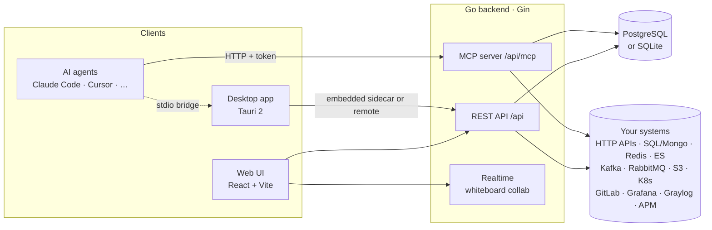

| Part | Repository | Stack |
|---|---|---|
| Backend | [patchman-api](https://github.com/PttemDev/patchman-api) | Go 1.26, Gin, GORM (PostgreSQL / SQLite), MCP Go SDK, franz-go (Kafka), client-go (Kubernetes) |
| Web UI | this repository | React 18, TypeScript, Vite 6, Tailwind CSS 4, Zustand, Monaco editor, Excalidraw, react-i18next |
| Desktop | this repository (`src-tauri/`) | Tauri 2 (Rust) running the Go backend as a sidecar on SQLite |
| MCP bridge | [patchman-api](https://github.com/PttemDev/patchman-api) (`cmd/mcp-bridge`) | stdio ⇄ HTTP bridge for agents talking to the desktop app |

```
patchman-api/   Go backend (cmd/server, cmd/mcp-bridge, internal/…, db/)
patchman-ui/    React web UI + Tauri desktop shell (src-tauri/)
  src/
    components/   feature UI (collections, request, response, mock, qa, runner, …)
    stores/       Zustand stores
    services/     API client
    hooks/ types/ shared hooks and types
  docs/           screenshots
```

---

## Development

```bash
# backend (patchman-api)
go build ./... && go test ./...

# web UI (patchman-ui)
npm run lint
npm run build          # tsc -b && vite build
npm run check:i18n     # every UI string present in en / tr / es / zh
```

Conventions:
- Every user-facing string goes through `react-i18next` (`t()`), with translations in all four locales.
- New connection-type tools follow the existing pattern: an encrypted secret, grants, audit entries and an MCP tool group.
- Lazy-loaded UI chunks use `lazyWithReload`, so open tabs survive a deploy.

---

## Security

Checks run on this repository before the initial public release (November 2026):

- [x] `npm run build` and `npm run check:i18n` pass
- [x] Source tree and production bundle scanned for committed secrets, `.env` files, signing keys and internal hostnames; none found
- [x] A desktop build made from this source tree was scanned for internal hostnames and signing identities; none found
- [x] No update manifests or private signing keys are part of the repository (only the updater public key, in `src-tauri/tauri.conf.json`)
- [x] `npm audit` reports no critical or high severity advisories
- [ ] `npm audit` still reports 13 moderate/low advisories that need major upgrades or have no upstream fix yet (`react-router-dom` 6 → 7, `katex` via `mermaid`, `@excalidraw/*`, and the `typescript-eslint` / `minimatch` dev tooling). See [SECURITY.md](SECURITY.md).

Re-checked for 1.67.1 (November 2026): `npm run build`, `npm run check:i18n` and `cargo check` (desktop shell) pass; the source tree was scanned again for secrets, internal hostnames and personal names; `npm audit` shows the same 13 moderate/low advisories listed above and nothing critical or high.

Re-checked for 1.68.2 (November 2026): `npm run build`, `npm run check:i18n` and `cargo check` (desktop shell) pass; the changes since 1.67.1 were scanned for secrets, internal hostnames and personal names; `npm audit` shows the same 13 moderate/low advisories.

Re-checked for 1.70.0 (November 2026): `npm run build`, `npm run check:i18n` and `cargo check` (desktop shell) pass; the changes since 1.68.2 (1.69.0 and 1.70.0) were scanned for secrets, internal hostnames and personal names; `npm audit` shows the same 13 moderate/low advisories. The Windows and Linux packages and update checks from GitHub Releases are new in this version and are built in CI, not on the maintainer's machine.

Re-checked for 1.72.0 (November 2026): `npm run build`, `npm run check:i18n` and `cargo check` (desktop shell) pass; the changes since 1.70.1 (1.71.0 to 1.72.0) and the new developer guide (`docs/dev/`, `AGENTS.md`) were scanned for secrets, internal hostnames and personal names; `npm audit` shows the same 13 moderate/low advisories.

Dependency notes: `xlsx` is installed from the SheetJS CDN (`0.20.3`) because newer releases are not published to npm, and `package.json` uses `overrides` to pin patched versions of `lodash-es`, `dompurify` and `nanoid`.

These checks are a point-in-time snapshot, not a security audit. Run `npm audit` regularly. To report a vulnerability, see [SECURITY.md](SECURITY.md).

## Community

Join the [PatchMan Slack workspace](https://join.slack.com/t/patchman-workspace/shared_invite/zt-4hjqey19u-~AxNN3qSh51RbOsedKTwdw) to ask questions, share feedback and ideas, and hear about new releases. Bug reports and feature requests are also welcome as GitHub issues.

## Contributing

Contributions are welcome: bug reports, fixes, new connection types and translations. See [CONTRIBUTING.md](CONTRIBUTING.md) for setup and the pull request flow.

The [developer guide](docs/dev/README.md) explains the architecture, the rules the code relies on, recipes for common changes and how to test them. AI coding agents read [AGENTS.md](AGENTS.md) (Claude Code loads it through `CLAUDE.md`).

Please report security issues privately, as described in [SECURITY.md](SECURITY.md), rather than in public issues.

## License

MIT. See [LICENSE](LICENSE).
